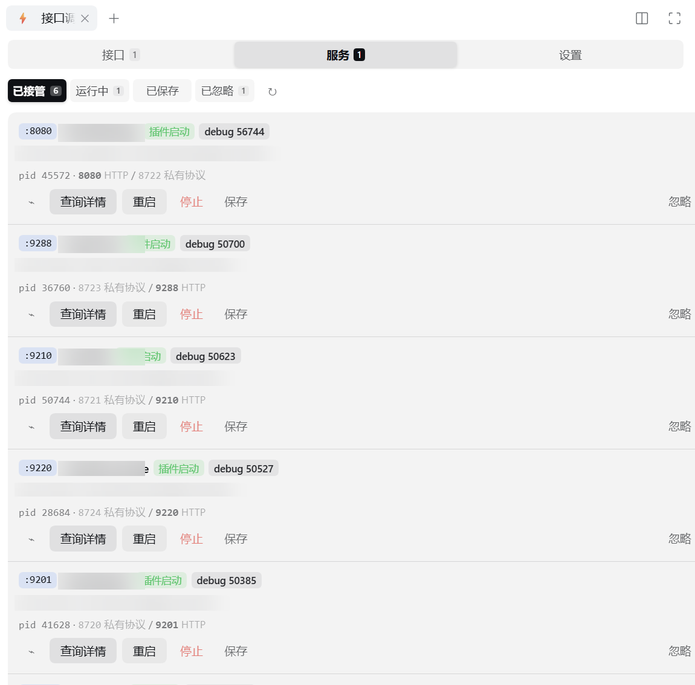
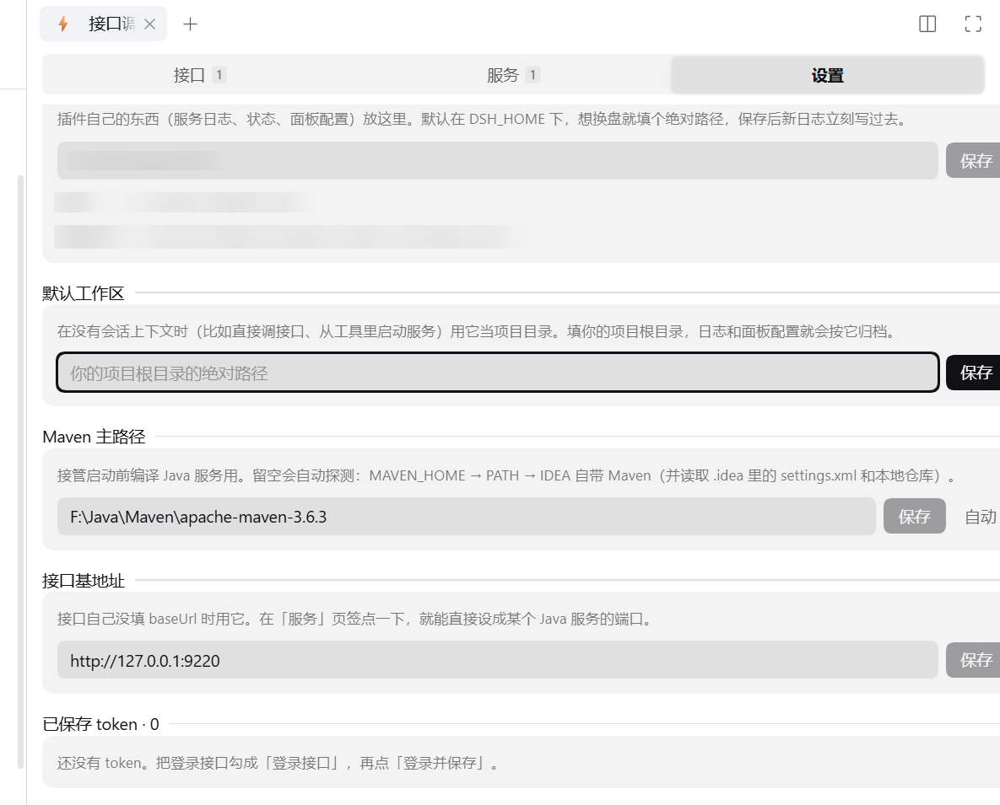
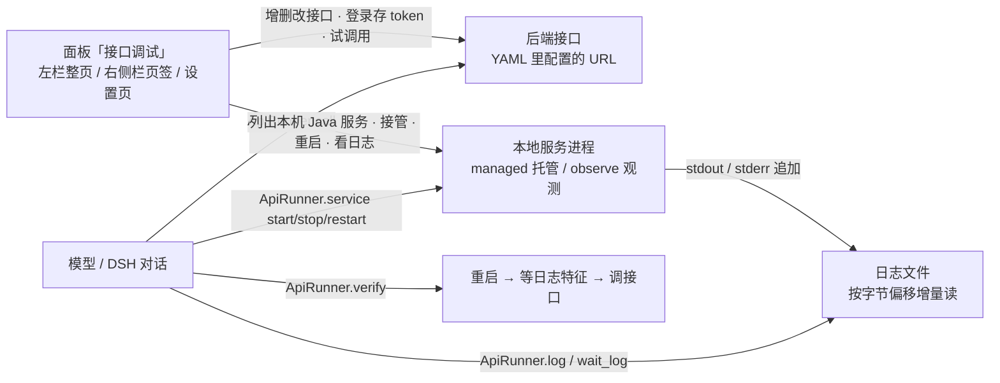

# dsh-api-runner

[](./LICENSE)
[](https://nodejs.org)
[](https://github.com/topics/dsh-plugin)

<!-- 被 dsh-plugin.org 收录后，把下面这行取消注释（slug 用详情页地址里的 owner/slug）：
[](https://dsh-plugin.org/plugins/lhhzmz229/dsh-api-runner)
-->

DSH 插件：把「后端接口清单」「本地服务启停」「日志增量读取」三件事交给模型直接调用，并提供一个面板做人工配置，形成「改完自己验」的闭环。

**不依赖任何第三方插件**：面板全部注册到 DSH 自带的席位（左栏全局页、右侧栏页签、设置页），装到任意一份 DSH 上都能用。

- **面板「接口调试」**：可视化增删改接口配置、登录并保存 token、点按钮试调用、列出本机所有运行中的 Java 服务并一键设为 baseUrl。同一个面板出现在三处——左栏图标（中栏整页，无会话也能开）、右侧栏页签（和终端/文件/任务并列，边看对话边调试）、设置页里的插件主页（只放跨项目的全局项）。
- **可配置接口**：在 YAML 里声明接口，或在面板里点选添加（方法、URL、请求头、body 模板），模型按 id 调用，占位符自动替换。
- **登录态**：把某个接口标记为登录接口，调用成功后按 `tokenPath` 取出 token 存进项目档，后续接口自动注入 `Authorization`，不用手工复制。
- **服务重启**：`managed` 模式由插件托管进程（能 start/stop/restart，DSH 重启后服务仍在跑）；`observe` 模式进程由 IDEA 启动，插件只轮询健康检查（配合 IDEA 的 restart 按钮）。
- **日志读取**：按文件 + 字节偏移增量 tail，支持正则过滤、等待特征出现，游标持久化，服务重启不丢。

> **能力分类**：开发与运维 ｜ **平台**：Windows / macOS / Linux ｜ **许可证**：MIT
> **一句话价值**：装上后模型能在对话里自己调接口、启停本地服务、读日志，改完代码自己验证。

## 效果

效果见下方截图（截图取自旧版，面板内容一致；新版入口在左栏图标、右侧栏页签和设置页）。



「接口调试」的设置页：数据目录、默认工作区、Maven 主路径、接口基地址。



> 截图中的服务名、包名与本机路径做了模糊处理。验证环境：DSH `V0.2.1-alpha.1` / Windows（[版本截图](./docs/verified-dsh-version.png)）。

## 安装

装好之后，模型可以在对话里直接列接口、调接口、启停/重启本地服务、按字节偏移增量读日志，
形成「改完自己验」的闭环，不用再手工复制 curl、切窗口重启服务、翻日志找报错。

### 从 npm 安装（推荐）

```bash
dsh plugin --profile web add dsh-api-runner
```

npm 上已发布 `dsh-api-runner@0.3.0`，这条是推荐路径，也是 DSH「插件中心」里一键安装的形式。

### 从 GitHub 源码安装

```bash
dsh plugin --profile web add github:lhhzmz229/dsh-api-runner
```

DSH 会把仓库 clone 到 profile 的 `node_modules` 下。写成带包名的
`dsh-api-runner@github:lhhzmz229/dsh-api-runner` 也等价。这条依赖本机有 `git`；装完重启 DSH（或把 `dsh-api-runner` bundle 关掉再打开）生效。

### 从 0.1.x 升级

0.2.0 有两个变化，**升级后需要硬刷新页面**（Ctrl/Cmd+Shift+R）：

1. **不再依赖 `dsh-better-sidebar`**。面板改成注册到 DSH 自带的席位，所以：
   - 装了 `dsh-better-sidebar` 的，那个侧边栏里不会再出现「接口调试」页签；
   - 面板现在在左栏 ⚡ 图标（中栏整页）、右侧栏页签、设置 → 接口调试 三处。
   - 顺带修掉一个老问题：旧版把 `betterSidebar` 写进 `inject`，没装那个插件时**整个 client half 不激活**，连设置页都不出现。
2. **新增一键启动**：「已保存」页签顶部可以一次拉起所有配方（逐个编译，已在运行的跳过，单个失败不影响其余）。

配置文件、面板数据、已保存的服务配方、日志目录都沿用原路径，升级不需要迁移。

### 从 0.2.0 升级

0.2.1 修了三个面板数据问题，**同样需要硬刷新页面**：

1. **示例参数能回显了**。以前填完保存，再点「编辑」输入框一定是空的（面板只存了解析后的对象，没存原文，回显时又只读原文）。
2. **保存不再丢 query**。以前面板接口按 id 整体覆盖，只要点一次「保存」，YAML 里配的 `query` 就被抹掉。现在表单里没有的字段会沿用原值。
3. **新增 query 编辑栏**。以前只能把 `?a=b` 塞进「路径」输入框，但没人会想到这么做。现在有独立的 query（JSON）栏，支持 `{占位}`，清空即删除。

数据本身不用迁移：之前被抹掉的 `query` 需要你重新填一次（或从 YAML 恢复）。

### 从 0.2.x 升级到 0.3.0

0.3.0 新增数据库能力，**需要硬刷新页面**，且有两个注意点：

1. **Node 版本要求提高到 `>=22.5`**（SQLite 用 Node 内置的 `node:sqlite`，22.5 起才有）。低版本 Node 上插件会加载失败，请先升级 Node。
2. **面板多了一个「数据库」页签**，支持 SQLite / MySQL / PostgreSQL / Oracle / 达梦。SQLite 开箱即用（零依赖）；其它类型需要按需装驱动，见「数据库」章节。
3. **面板 UI 重做**：顶部页签和一级标题改成胶囊分段控件，窄面板下横向滚动不换行。

原 dsh-db-tool 用户可以卸载它了——数据库能力已合并进来，且不再依赖 `betterSidebar`（原插件把 `betterSidebar` 当硬依赖，服务未就绪时会卡住整个 web 启动）。

### 本地开发：link 安装

```bash
# 在插件目录下装依赖（只有一个运行时依赖 yaml；npm cache 目录无写权限时用 --cache 指到可写目录）
npm install

# 以 link 方式装进 desktop profile
dsh plugin --profile desktop add "link:/绝对路径/到/dsh-api-runner"
```

Windows 下 link 路径写成 `link:D:/path/to/dsh-api-runner` 也等价。

`dsh` 命令不在 PATH 时，用桌面版自带运行时（路径按你的安装位置调整）：

```bash
# Windows
"<DSH 安装目录>/resources/runtime/bin/node.cmd" "<DSH 安装目录>/resources/app.asar/dsh/bin/dsh.js" plugin --profile desktop add "link:..."
# macOS / Linux
"<DSH 安装目录>/resources/runtime/bin/node" "<DSH 安装目录>/resources/app.asar/dsh/bin/dsh.js" plugin --profile desktop add "link:..."
```

装好后 profile 的 `package.json` 会出现依赖 `dsh-api-runner` 与 `dsh.profile.bundles` 里的 `dsh-api-runner` 条目；
插件自己的 `cordis.patch.yml` 负责把 entry 插进依赖树。

侧边栏页签**不依赖任何第三方插件**。面板注册进 DSH 自带的 slot 席位：

| 席位 | 面板形态 |
| --- | --- |
| `sidebar.panellist` + `main` | 左栏图标 → 中栏整页（和「插件」「任务计划」并列，无会话也能打开） |
| `sidebar.right.pane.tab` + `.title` | 右侧栏页签（和终端/文件/任务并列，边看对话边调试） |
| `settings.section` | 设置页里的插件主页（只放默认工作区、数据目录、Maven 主路径这类全局项） |

这三个席位由 `@deepseek-ai/dsh-client-ui-sidebar` 和 `@deepseek-ai/dsh-client-ui-sidebar-right`
（都是 DSH 自带）声明，所以任何一份完整 DSH 上都有。宿主侧的工具（`ApiRunner`）与 HTTP 路由
不依赖这些席位，即使 UI 缺席位也照常工作。

## 权限与风险

安装前请确认这些行为都在你的预期内：

| 项目 | 说明 |
| --- | --- |
| 执行本地命令 | 用 `jps` / `jcmd` / `mvn` / `netstat` / `lsof` 发现、接管、启停 Java 进程；`managed` 模式会按配置直接拉起与结束子进程 |
| 发起 HTTP 请求 | 只请求你在 YAML 或面板里配置的 URL，可按配置注入 `Authorization` 头 |
| 读取本地文件 | 读取你配置的日志文件（按字节偏移增量读），内容只回给模型，不上传 |
| 写入本地文件 | `<数据目录>/` 下的状态与 UI 配置；面板保存的 token 明文落在 `api-runner-ui.json`（见「已知限制」） |
| 外联上报 | 无遥测、无统计上报，插件自身不发起任何外部请求 |

## 兼容与运行要求

- **DSH**：`>=0.1.0-rc.6 <0.2.0-0 || >=0.2.0-rc.1 <0.3.0-0`
- **已验证环境**：DSH `0.2.1-alpha.1` / Windows
- **Node.js**：`>=22.5`（SQLite 用内置 `node:sqlite`，22.5 起才有）
- **平台**：Windows / macOS / Linux（进程与端口发现按平台分流）
- **可选环境**：JDK（`jps` / `jcmd`，用于 Java 服务发现与接管）、Maven（`mvn`，用于接管时编译）
- **可选数据库驱动**：SQLite 用 Node 内置，无需安装；MySQL 需 `mysql2`、PostgreSQL 需 `pg`、Oracle 需 `oracledb`（原生模块）、达梦需 `dmdb`（纯 JS）。都是按需加载，不装只影响对应类型

## 配置

配置文件按「内置默认 → 全局 → 项目」合并，后者覆盖前者：

| 位置 | 说明 |
| --- | --- |
| `${DSH_HOME}/api-runner.yml` | 全局，所有项目生效 |
| `<项目 cwd>/.dsh/api-runner.yml` | 项目级，建议放这个 |

文件名也支持 `api-runner.yaml` / `dsh-api-runner.yml`。**改完保存即生效**（按 mtime + size 缓存），不用重启 DSH。

完整示例见 [dsh-api-runner.example.yml](./dsh-api-runner.example.yml)，最小可用示例：

```yaml
defaults:
  timeoutMs: 30000
  headers:
    Content-Type: application/json

env:
  TOKEN: ${DEV_TOKEN}          # 引用环境变量

apis:
  - id: get-user
    name: 查询用户
    method: GET
    url: http://127.0.0.1:8080/api/users/{id}
    headers:
      Authorization: "Bearer ${TOKEN}"

  - id: create-order
    method: POST
    url: http://127.0.0.1:8080/api/orders
    body:
      userId: "{userId}"
      amount: "{amount}"

services:
  # 插件托管：mvnw spring-boot:run
  - id: app
    mode: managed
    cwd: ../
    command: ./mvnw.cmd
    args: ["spring-boot:run"]
    logPath: ./logs/app.log
    startupTimeoutMs: 90000
    health:
      url: http://127.0.0.1:8080/actuator/health

  # IDEA 里跑，插件只观测（配合 IDEA restart 按钮）
  - id: idea-app
    mode: observe
    health:
      url: http://127.0.0.1:8080/actuator/health
      ports: [8080]

logs:
  - id: app-log
    path: ./logs/app.log
```

### 两种占位符

| 写法 | 何时展开 | 用途 |
| --- | --- | --- |
| `${NAME}` | 加载配置时 | 环境变量 / `env:` 段里定义的值，用于 URL、header、command |
| `{name}` | 调用接口时 | 模型通过 `params` 传入，替换 URL 与 body 里的同名占位 |

`headers` 里的 `${VAR}` 会展开成真实值，但在返回给模型的 `request.headers` 里按名字脱敏（`token`/`secret`/`password`/`key`/`auth` 等一律 `demo***3456`）。

## 工具与动作

模型通过 `ApiRunner` 工具调用，`action` 取值：

| action | 作用 |
| --- | --- |
| `describe` | 列出可用接口、服务、日志（含每个接口需要的参数名），不返回 header 值 |
| `call` | 按 `api_id` 调接口，`params` 传占位符；已保存 token 会自动注入 |
| `login` | 调登录接口并把 token 存进项目档（`api_id` 指向配了 `login.tokenPath` 的接口） |
| `java` | 本机 Java 服务：`java_action` = `list` / `detail`（详情+日志）/ `start`（接管启动）/ `stop` / `restart` / `log` / `ignore` / `unignore` / `save`（保存启动配方）/ `unsave` / `start_saved`（按配方启动，不需要 IDEA 里先有进程）/ `start_all`（一键启动所有已保存的服务，可用 `java_ids` 只启部分）/ `settings`（读或改全局设置）/ `status`，详见下文 |
| `db` | 数据库：`db_action` = `list_connections` / `test` / `save` / `delete` / `query`（执行 SQL，**默认只读**）/ `list_databases` / `list_tables` / `describe_table`，详见下文 |
| `service` | `service_action` = `start` / `stop` / `restart` / `wait` / `status` |
| `log` | 增量读日志（`pattern` 正则过滤，`max_bytes` / `max_lines` 限流） |
| `wait_log` | 等某个特征出现在日志里（`timeout_ms` 超时） |
| `reset_log` | 把游标重置到文件末尾 |
| `verify` | 一条命令串起「重启 → 等日志特征 → 调接口」，返回分步结果 |

`verify` 只有在所有步骤都成功（observe 模式下无法自动重启除外）才返回 `ok: true`；失败时给出 `code`（如 `STEP_FAILED:log`）与可读 `message`。

## 典型流程



典型的一轮「改完自己验」：改代码 → `service restart` → `wait_log` 等 `Started Application` →
`call` 打接口看返回 → 不对就 `log` 拉最近几百字节定位报错。也可以直接用 `verify` 一条串起来。

## 面板

同一个「接口调试」面板出现在三个入口，内容一致：

- **左栏图标**（`sidebar.panellist` + `main`）：点 ⚡ 图标切到中栏整页。整页宽，适合配接口、看日志；没有会话时也能打开（host 回落到设置里的默认工作区）。
- **右侧栏页签**（`sidebar.right.pane.tab`）：和终端/文件/任务页签并列，边看对话边调试。会话级，宽度窄，所以内容分成三个页签，顶部固定、下方独立滚动，一次只看一块。
- **设置 → 接口调试**（`settings.section`）：只放默认工作区、数据目录、Maven 主路径这类跨项目的全局项。

右侧栏很窄，所以下面按页签说明布局：

**接口页签**
- 顶部是**按项目分类**的二级页签（只有存在第二个项目时出现）：第一个永远是当前工作区，后面是其它已知项目（显示成末段目录名，重名时带上上一级；页签多了横向滚动）。二级页签没有灰底容器、选中项是品牌色实心块，和顶部那排灰底分段控件一眼能分开。
- 项目清单来自「当前会话的工作区 + 设置里的默认工作区 + 面板里存过的所有项目」，所以还没配过接口的项目也会出现——不然切不过去。
- 切到别的项目后，接口列表、基地址、token、保存/编辑/删除**都作用于那个项目自己的档**（请求带 `project`，后端按项目桶读写），不会污染当前工作区。要回到自己项目点第一个页签。
- 当前项目下：顶部筛选框可按 id / 名称 / 地址过滤；右侧「新增」展开内联编辑表单。
- 每条接口显示方法徽章、名称、地址（host 弱化、路径强化）、来源徽章（`YAML` = 来自配置文件，无徽章 = 面板新建）、占位参数列表。
- 行内操作：「测试」（用示例参数调用一次）、「登录并保存」（仅登录接口）、复制地址、清除 token、编辑、删除（只允许删面板自己建的）。
- 调用结果是一张卡片：状态码、耗时、响应大小，可在「响应 / 响应头 / 请求」之间切换，带复制与关闭。
- **编辑表单**：id / 名称 / 方法 / 路径 / baseUrl / 说明 / **query（JSON）** / 请求头（JSON）/ body（JSON）/ 示例参数（JSON）/ 用哪个 token；勾「是登录接口」后展开 tokenPath（如 `data.token`）、注入头（默认 `Authorization`）、前缀（默认 `Bearer `）。
  - **query 单独一栏**，别把 `?a=b` 塞进「路径」。query 支持 `{占位}`，如 `{"matterCd":"{matterCd}"}`，调用时按参数展开；只写在 query 里的占位符也会出现在下方的「占位参数」提示行。
  - 面板保存时，表单里没有的字段（如 YAML 里的 `query`）会沿用原值，不会被抹掉。

**服务页签**
- 每 5 秒刷新。服务页顶部还有一排**二级页签**（**已接管** / **运行中** / **已保存** / **已忽略**）。这一排样式和顶部「接口 / 服务 / 设置」不同：没有灰底容器，选中项是品牌色实心块，用来区分"页面级"和"分组级"两层导航。一次只看一组，不再纵向堆四块。
- 如果「已接管」是空的、而确实有服务在跑，进入服务页时会自动落到「运行中」，不用多点一次。
- 每行显示 pid、主类、端口、归属标记、debug 端口、`spring.profiles.active`。
- **端口带角色标注**：一个服务常常监听两个端口——业务 HTTP 端口（如 8080）和 **Sentinel 规则端口**（如 8719，回 `400 Invalid command`，不能当接口地址）。插件会逐个探测，把真正讲 HTTP 的标成 `HTTP` 并用作 baseUrl，Sentinel 端口灰显标注。
- 接管/重启时如果进程参数里读不到 `server.port`（端口常写在配置中心或外部配置文件里），插件会在进程起来后持续扫描真实监听端口并**回填到托管记录**，所以「已接管」里的端口与 `HTTP` 标注不会因为「参数里没端口」而空着。
- **接管启动** = 先 `mvn` 增量编译，再结束 IDEA 那个进程，然后用**同样的 classpath 和主类**重新拉起，交给插件托管；此后可在面板里停止、重启、看实时日志。
- **保存** 把当前进程的 classpath / 主类 / JVM 参数存成一套配方。存过之后**不需要 IDEA 里先有进程**：到「已保存」页签里点「启动」即可（会先编译，端口被占会提示你先停 IDEA 那份）。
- **一键启动** 在「已保存」页签顶部：把所有配方逐个拉起来，不用一个个点。
  - **已在运行的服务自动跳过**，不会把正在调试的进程踢掉。
  - **逐个启动、遇错继续**：一个服务失败不影响后面的，最后一起汇报「成功 N / 跳过 N / 失败 N」，每个服务的结局逐条列在进度卡里。
  - 为什么要串行：同一模块的 Maven 编译是互斥的（都写 `target/`），并发跑会互相覆盖产物；而且一个服务起不来通常意味着环境有问题，先看到那条明确原因比满屏报错有用。
  - 编译要几分钟，所以**在后台跑**：点完按钮立刻返回，面板每 1 秒轮询进度（`3/8 正在处理 xxx`），期间页面照常可操作。
  - 模型侧对应 `java_action=start_all`，可用 `java_ids` 只启其中几个。
- **查询详情**进入日志页：托管进程读插件写的 stdout 文件，IDEA 进程读它自己的 logback 文件（`<工作目录>/logs/<服务名>/info.log`）。
  - 打开时默认只读**最后 200 行**（可点 100 / 200 / 500 / 1000 快速切换，右侧输入框还能自己填 1–5000，回车或失焦生效），之后按字节偏移增量追加，1.5 秒静默刷新且不打断你手动滚动。
  - 支持**自动换行**开关（默认开）、在插件输出多段日志与 info.log / error.log 之间切换。
  - **每次启动写一个独立日志文件**（`java-logs/<服务名>/<时间戳>.log`），重启多次不会混在同一个文件里，历史段可以单独翻。
- 「忽略」只是把这个服务从「运行中」里收起来，**不影响进程本身**，可在「已忽略」页签里点「取消忽略」恢复；已忽略的行只保留「取消忽略」一个动作，避免误点接管。
- 「用作 baseUrl」把项目接口基地址设为 `http://127.0.0.1:<HTTP 端口>`。

**设置页签**
- 接口基地址（接口自己没填 baseUrl 时用它）、已保存 token 列表（脱敏值 + 清除）、配置来源（项目路径、项目 key、命中的 YAML 文件）。

**DSH 设置里的插件主页**：设置 → 「接口调试」页（`settings.section`，order 80），放跨项目的全局项——**默认工作区**（没有会话上下文时用它当项目目录）、**Maven 主路径**（接管启动前编译用；留空自动探测 MAVEN_HOME → PATH → IDEA 自带，并读取项目 `.idea` 里的 settings.xml 与本地仓库）与**数据目录**（必须是绝对路径，改完后新日志立刻写过去；留空即回到 `DSH_HOME`）。

**数据位置**：面板数据存在 `${DSH_HOME}/api-runner-ui.json`（按项目 key 分开），YAML 里的接口与面板接口**按 id 合并**：面板改的同名 id 覆盖 YAML 的值，面板新增的与 YAML 的并存。

### 登录接口怎么写

```yaml
apis:
  - id: login
    method: POST
    url: /api/login
    baseUrl: http://127.0.0.1:8080
    body:
      username: "{username}"
      password: "{password}"
    login:
      tokenPath: data.token      # 从响应 JSON 取 token 的路径，支持 a.b[0].c
      header: Authorization      # 存下来后注入到哪个头
      prefix: "Bearer "          # 加在 token 前面

  - id: me
    method: GET
    url: /api/me                 # 自动带上 Authorization: Bearer xxx
    baseUrl: http://127.0.0.1:8080
```

然后 `ApiRunner { action: 'login', api_id: 'login', params: { username: 'alice', password: 'p@ss' } }`；
之后调 `me` 就会带 token，也可以在 `call` 里用 `token_from` 临时指定用哪个登录态。

`tokenPath` 没写对时不会白跑一趟：登录成功后会在响应里找像 token 的字段，
只有一个候选就自动用它并保存，同时告诉你该把它改成什么；
有多个候选则列出来让你选。面板里配置的接口会自动把这个路径写回配置，下次不再提示。

### 关于 IDEA 里的服务

**推荐做法：接管。** IDEA 起的服务，插件在服务页签里点「接管启动」（或调 `ApiRunner { action: 'java', java_action: 'start', pid }`），流程是：
1. 从 `jcmd` 读出该进程的 java 路径、工作目录、完整 classpath、主类、JVM 参数；
2. 用 `mvn -pl <模块> -am compile -DskipTests` 增量编译（模块与 reactor 根从 classpath 里的 `target/classes` 反推；Maven 依次找设置页里配的「Maven 主路径」→ `MAVEN_HOME`/`M2_HOME` → PATH → IDEA 自带）。编译参数会自动带上项目 `.idea/workspace.xml` 里 IDEA 用的 `settings.xml` 与本地仓库（`-s` / `-Dmaven.repo.local`），找不到时退回 Maven 安装目录的 `conf/settings.xml`；
3. 结束原进程树，等端口释放（Windows 用 `taskkill /T /F`；macOS/Linux 杀进程组 `kill -9 -<pid>`）；
4. 用同样的 classpath/主类重新拉起，日志写 `<数据目录>/java-logs/<主类名>/<时间戳>.log`（每次启动一个文件），等端口健康后返回新 pid。

接管后 IDEA 的 Run 窗口会显示该进程「已结束」——因为新进程不再挂在 IDEA 下。但**调试能力没丢**：重启时会把原来的 `suspend=y` 调试参数改写成 `server=y,suspend=n,address=127.0.0.1:<原端口>`，你在 IDEA 里用「Remote JVM Debug」连这个端口就能继续断点。编译失败时不会动原进程。

插件启动的进程带 `-DdshApiRunner.runId=<服务名>` 标记，所以服务列表能稳定区分「谁起的」；即使状态文件丢了也能认出来。

另外两种模式仍然可用：
- **IDEA Run/Debug 按钮 + 不想被接管** → 配 `mode: observe`。模型调 `verify` 时不会杀进程，只等健康检查通过；需要重启时你在 IDEA 里点重启，模型调 `service action=wait` 等你起来。
- **完全交给插件** → 配 `mode: managed`，`command` 写成 `mvnw.cmd spring-boot:run` 这类可拉起的命令。注意 IDEA 和插件不要同时占用同一个端口。

## 数据库

把数据库能力合并进来，替代原来的 `dsh-db-tool`。

> **为什么合并**：原 `dsh-db-tool` 把 `betterSidebar` 当**硬依赖**（`inject` 里列出且没有兜底），服务没就绪就一直 `pending`，拖垮整个 web 启动（`web boot: 1 entry did not activate`）。本插件的数据库模块**不依赖任何 DSH 服务**，只依赖 Node 内置能力。

### 支持的数据库

| 类型 | 驱动 | 说明 |
| --- | --- | --- |
| `sqlite` | **Node 内置 `node:sqlite`** | 零依赖、零原生编译。填文件路径，或 `:memory:` 用内存库 |
| `mysql` | `mysql2`（纯 JS） | 需要 `npm install mysql2` |
| `postgres` | `pg`（纯 JS） | 需要 `npm install pg` |
| `oracle` | `oracledb`（原生模块） | 需要 `npm install oracledb`，且要匹配 Node ABI |
| `dm` | `dmdb`（纯 JS） | 达梦 DM8，需要 `npm install dmdb`。默认端口 5236 |

驱动都是**按需动态加载**：没装某个驱动只会让那种类型的连接报「缺少 xx 依赖」，不会让整个插件加载失败。SQLite 开箱即用，不需要装任何东西。

### 面板

「数据库」子页（和「接口 / 服务 / 设置」并列）分三块：

- **连接管理**：新增 / 编辑 / 删除 / 测试。密码框是 `type=password`，编辑时不回填，留空表示不修改。
- **执行 SQL**：写 SQL → 点「执行」→ 结果表格（列头 + 行 + 行数/耗时）。**只读模式默认开启**，拒绝 INSERT/UPDATE/DELETE/DDL；关掉时会显示醒目提示。
- **表结构**：选连接 → 刷新表清单 → 点表名看字段/类型/可空/默认值/主键/索引，同时自动把 `SELECT * FROM xxx LIMIT 100` 填进 SQL 框。

### 模型调用

```
action=db, db_action=query, connection_id=<id>, sql="SELECT * FROM t WHERE id = ?", db_params=[7]
```

默认只读。要写数据必须显式传 `db_readonly=false`。

```jsonc
// 保存一个 SQLite 连接
{ "action": "db", "db_action": "save",
  "connection": { "name": "本地库", "type": "sqlite", "database": "D:\\data\\app.db" } }

// 看表结构
{ "action": "db", "db_action": "describe_table", "connection_id": "<id>", "table": "users" }
```

### 安全设计

| 项 | 做法 |
| --- | --- |
| 密码存储 | AES-256-GCM 加密，密钥由机器特征派生。**落盘文件与任何返回值里都没有明文**，列表只给掩码 |
| SQL 注入 | 一律参数化（`?` / `$1` / `:1`），`db_params` 传值，**不要拼字符串** |
| 多语句 | 只允许单条。用「跳过字符串/注释」的扫描判断，所以 `WHERE note = 'a;b'` 不会被误判 |
| 只读保护 | 默认开启，非 SELECT/WITH/SHOW/DESCRIBE/EXPLAIN/PRAGMA 一律拒绝 |
| 超时 | 默认 30s，超时报错而不是卡死 |
| 结果集 | 默认上限 1000 行，超出截断并提示真实总行数 |
| 错误信息 | 驱动异常会抹掉 `password=xxx` 和 `://user:pass@` 这类片段再返回 |

### 已知限制

- **SQLite 是同步驱动**（`node:sqlite` 的 `DatabaseSync`）：超大结果集会阻塞事件循环。行数上限（默认 1000）能挡住大部分场景。
- **`oracledb` 是原生模块**：如果 Node ABI 不匹配会加载失败，此时该类型连接报错，但其它类型不受影响。确实需要时再单独装并验证。
- **达梦（dmdb）已知问题**：连接失败后它自己的池清理会抛 `TypeError: ... reading 'log'`（未捕获异步异常）。插件已加防护拦掉这个精确签名，不会带崩宿主；但连接失败本身仍会正常报错。
- 连接是**跨项目**的（不按 cwd 归档）：同一套库常被多个项目共用，按项目归档反而每次换项目都要重配。

## HTTP 接口

除工具外，插件还注册了同源路由（需要 DSH 会话认证）：

- `GET /dsh-api-runner/api/config` → 配置摘要
- `POST /dsh-api-runner/api/call` → `{ api_id, params }`
- `POST /dsh-api-runner/api/service` → `{ service_id, service_action }`
- `POST /dsh-api-runner/api/log` → `{ log_id, ... }`
- `GET /dsh-api-runner/api/ui` → 面板数据（当前项目的接口与 token 状态、已忽略的 Java 服务、已知项目清单 `projects[]`；带 `?project=<绝对路径>` 可切到别的项目）
- `POST /dsh-api-runner/api/ui/api` → 保存/覆盖一个面板接口
- `POST /dsh-api-runner/api/ui/api/delete` → `{ id }`
- `POST /dsh-api-runner/api/ui/base-url` → `{ baseUrl }`
- `POST /dsh-api-runner/api/ui/token/clear` → `{ login_id }`
- `POST /dsh-api-runner/api/login` → `{ api_id, params }`
- `GET /dsh-api-runner/api/java` → 本机 Java 服务列表（含每个端口的角色、忽略状态、日志路径、已保存配方）
- `POST /dsh-api-runner/api/java/bind` → `{ binding: { pid, port, mainClass } }`
- `POST /dsh-api-runner/api/java/unbind` → `{ pid }`
- `POST /dsh-api-runner/api/java/ignore` → `{ item: { mainClass, name, kind } }` 忽略（只是不显示）
- `POST /dsh-api-runner/api/java/unignore` → `{ item: { mainClass, name, kind } }`
- `POST /dsh-api-runner/api/java/start` → `{ pid, port?, compile? }` 接管启动
- `POST /dsh-api-runner/api/java/stop` → `{ id | pid }`
- `POST /dsh-api-runner/api/java/restart` → `{ id | pid, compile? }`
- `POST /dsh-api-runner/api/java/save` → `{ id | pid }` 保存启动配方
- `POST /dsh-api-runner/api/java/unsave` → `{ id }`
- `POST /dsh-api-runner/api/java/start-saved` → `{ id, compile?, port?, debug?, timeout_ms? }` 按配方启动
- `POST /dsh-api-runner/api/java/start-all` → `{ ids?, compile?, restart?, timeout_ms? }` 一键启动（后台跑，立刻返回 `{ batchId, total }`；`ids` 省略即全部已保存的）
- `GET /dsh-api-runner/api/java/start-all/status?batch=<batchId>` → 批次进度 `{ finished, done, total, current, items, result }`（`batch` 省略取最近一个）
- `GET /dsh-api-runner/api/db` → 数据库连接列表（密码只给掩码）
- `POST /dsh-api-runner/api/db/test` → `{ connection_id }` 或 `{ connection }` 试连
- `POST /dsh-api-runner/api/db/save` → `{ connection }` 保存/更新连接
- `POST /dsh-api-runner/api/db/delete` → `{ connection_id }` 删除连接
- `POST /dsh-api-runner/api/db/query` → `{ connection_id, sql, params?, readonly?, max_rows?, timeout_ms? }` 执行 SQL
- `GET /dsh-api-runner/api/db/databases?connection_id=` → 库清单
- `GET /dsh-api-runner/api/db/tables?connection_id=&database=` → 表清单
- `GET /dsh-api-runner/api/db/table?connection_id=&name=` → 表结构（字段 + 索引）
- `GET /dsh-api-runner/api/java/log?id=<服务名>&from=<字节偏移>` → 插件启动服务的日志增量
- `GET /dsh-api-runner/api/java/detail?id=<id 或 pid>&source=&from=&lines=&max_bytes=` → 服务详情 + 日志（含可选日志文件清单；不给 `from` 时按 `lines` 取末尾若干行）
- `GET /dsh-api-runner/api/settings` → 全局设置（默认工作区、Maven 主路径、数据目录、生效目录）
- `POST /dsh-api-runner/api/settings` → `{ settings: { dataDir?, workspace?, mavenHome? } }`

未认证返回 401 JSON（`{ok:false, code:'UNAUTHORIZED'}`）。面板请求带 `x-dsh-session-id` 让 host 解析项目 cwd；没有会话时用 `?cwd=` 或 body 里的 `cwd` 兜底（必须是绝对路径）。

## 状态与清理

- 运行状态：`<数据目录>/api-runner-state.json`，`logs` 与 `services` 两个命名空间互不覆盖。
- 面板数据：`<数据目录>/api-runner-ui.json`，存 baseUrl、面板接口、登录态、token（含明文，注意别泄漏）、已忽略的 Java 服务清单、已保存的启动配方。
- 插件设置：`<数据目录>/api-runner-settings.json`，存默认工作区、Maven 主路径与自定义数据目录（本身永远在 `DSH_HOME` 下，否则会先有鸡还是先有蛋）。
- Java 服务日志：`<数据目录>/java-logs/<服务名>/<时间戳>.log`，每次启动一个文件。
- 数据目录默认是 `DSH_HOME`，可在 DSH 设置 →「接口调试」里改成任意绝对路径。
- 卸载插件不会杀 `managed` 服务（故意设计，避免 DSH 重启把后端带停）；需要时手动停或调 `service_action=stop`。

## 开发

```powershell
node test/smoke.mjs     # 单元 + 集成（起临时 http server 当后端）
node test/plugin.mjs    # 插件入口契约 + 面板 HTTP 路由（桩 ctx）
node test/client.mjs    # client bundle 形态（__ModuleLoader__ + registerTab）
node test/managed.mjs   # managed 服务启停（真起 node 进程）
node test/java.mjs      # 接管 IDEA 服务（真起 JVM：快照/剥调试参数/编译/停止/重启）
```

### 改完源码要重新装载（重要）

DSH 用 ESM 动态 import 加载插件，Node 按 **模块 URL** 缓存。在同一个 DSH 进程里关掉再打开 bundle 只会重跑 `apply()`，
**不会重新 import 模块**，所以直接改 `src/` 看不到任何变化。必须让入口 URL 变化：

```powershell
node scripts/stage.mjs     # 复制 src/ → build/vN/，并改写 cordis.patch.yml 的入口 URL
```

然后到 DSH 里把 `dsh-api-runner` bundle 关掉再打开。`scripts/stage.mjs --clean` 会顺手清理旧版本目录。

反过来，**提交代码前要跑 `node scripts/stage.mjs --release`**：它把 `cordis.patch.yml` 的入口从本机 `build/vN/main.js` 的 `file://` 路径改回包名 `dsh-api-runner`，这样别人装上才能正常解析入口，仓库里也不留本机绝对路径。

## 已知限制

- 只支持 HTTP/HTTPS 接口，没有 multipart 文件上传。
- `managed` 服务的进程发现依赖状态文件里的 pid；pid 被系统回收复用后可能误判存活（`isPidAlive` 只做存在性检查）。
- 日志按字节读，多字节编码（GBK 等）跨读取边界时可能出现半个字符。
- 面板的接口页签负责「配置 + 试调用」，服务页签负责「列表 + 接管/停止/重启 + 实时日志」；`verify`（重启→等日志→调接口一条龙）仍只在对话里让模型调工具完成。
- Java 服务发现依赖 `jps`（取 `JAVA_HOME/bin/jps`，找不到就用 PATH 上的 `jps`），没有 JDK 时列表为空并给出提示；端口来源按平台分流（Windows `netstat -ano -p tcp`，macOS/Linux `lsof -nP -iTCP -sTCP:LISTEN`，没有 lsof 时退回 Linux `netstat -tlnp`），同一 pid 多端口时会逐个做 HTTP 探测挑出真正讲业务协议的端口。
- Maven 探测顺序：设置里的「Maven 主路径」→ `MAVEN_HOME` → `M2_HOME` → `PATH` → IDEA 自带 Maven（三个平台都会找 IDEA 进程路径）；找不到 `mvn` 时接管启动会跳过编译并给出提示，服务仍按原参数拉起。
- 接管依赖 `jcmd`（同一个 JDK），且要求原进程是标准启动器起的（有 classpath）。用 `-jar` 或 argfile 启动的进程无法原样还原。
- 接管后进程不再挂在 IDEA 下（IDEA Run 窗口显示已结束），需用「Remote JVM Debug」连原调试端口继续断点。
- 面板保存的 token 是明文落在 `<数据目录>/api-runner-ui.json`（只在 UI 与工具输出里脱敏），本机共用的场景请自行注意。
- 按配方启动要求配方里有完整的 classpath（所以得先「保存」过一次）；`.cmd`/`.bat` 的 Maven 用 `cmd.exe` 调用，路径含空格已处理。
- 日志首屏按行读末尾，历史大文件（几百 MB）会被截断到所选行数；要看更早的内容请切换日志文件或加大行数。

## 常见问题（排查）

**装完看不到「接口调试」？**
面板注册到 DSH 自带的三个席位，不需要任何第三方插件。排查顺序：

1. 左栏有没有 ⚡ 图标（`sidebar.panellist`）。有就说明面板挂上了，点它切到中栏整页。
2. 右侧栏页签需要先展开右侧栏（会话标题栏最右边的按钮）；它只在有会话时出现。
3. 设置 → 接口调试 是全局项页，和上面两个内容不同，不要拿它判断面板是否挂载。
4. 都没有就硬刷新页面（Ctrl/Cmd+Shift+R）。插件刚装上/刚升级时，浏览器可能还跑着旧的 client bundle。

**工具列表里没有 `ApiRunner`？**
先看 profile 的 `package.json` 里有没有 `dsh-api-runner`、`dsh.profile.bundles` 里有没有对应条目、bundle 是否处于启用状态，再确认 DSH 版本在兼容范围内。

**面板是空的 / 看不到接口？**
面板按「项目」归档。没有会话上下文时用设置里的「默认工作区」当项目目录；那里没填就落到 `default` 桶。先在设置里把默认工作区填成你的项目根目录，或直接在一个会话里打开面板。

**别人装上却报「找不到入口 / build/vN/main.js 不存在」？**
仓库里的 `cordis.patch.yml` 被 `scripts/stage.mjs` 写成了本机 `file://` 路径。提交前跑 `node scripts/stage.mjs --release` 改回包名，再提交。

**`ApiRunner { action: 'java', java_action: 'list' }` 返回空列表？**
服务发现依赖 `jps`（优先 `JAVA_HOME/bin/jps`，其次 PATH）。没有 JDK 时列表为空并给出提示；有 JDK 仍为空，检查目标服务是否用标准启动器起的。

**接管启动失败 / 端口一直没起来？**
接管要求 `jcmd` 能读到完整 classpath，`-jar` 或 argfile 启动的进程无法原样还原；原端口被 IDEA 那份占着会先提示你先停掉；找不到 `mvn` 时跳过编译、仍按原参数拉起。端口写在配置中心时，插件会在进程起来后持续扫描真实监听端口并回填。

**日志读不到，或者出现半个字符？**
`logPath` 与 `cwd` 的相对路径按项目工作目录展开（没有工作区时按配置文件所在目录）。日志按字节读，GBK 等多字节编码跨读取边界时可能出现半个字符，换 UTF-8 日志或调大 `max_bytes`。

**接口一直 401？**
多半是面板里保存的 token 过期了。点「清除 token」后重新「登录并保存」；或检查登录接口的 `tokenPath`、注入头与前缀是否和实际响应一致。

## 许可证

MIT，见 [LICENSE](LICENSE)。
